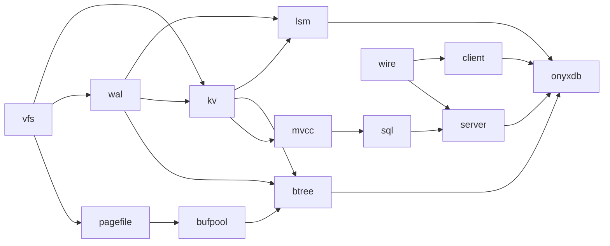

# onyxdb

A SQL database built from scratch in Rust, with the standard library only, to
understand how databases work inside. The reading behind each part is in
[engineering-notes](https://github.com/PPRAMANIK62/engineering-notes).

**Early work in progress.** The storage foundation is done. The first version
you can run, a crash-safe key-value store (M1), is next.

## The goal

onyxdb v1.0 does what a real database must do. It stores data in its own
format, survives crashes, caches pages, keeps indexes, runs SQL, isolates
transactions and serves many clients over its own protocol. It has two storage
engines, a B-tree and an LSM tree, behind one interface. Where there is a
choice, it takes the simplest design that is still correct, and speed comes
second. Replication and sharding are not part of it.

## What works today

- **Pages on disk,** fixed-size and checksummed, with a freelist and overflow
  chains, cached in a buffer pool.
- **A write-ahead log** that keeps every synced record after a crash, and stops
  after a failed `fsync` instead of trusting it.
- **One key-value interface** for every storage engine, and a model engine that
  survives crashes.
- **Every layer tested against a simple model,** and crashed after every write
  it makes, on a file system in memory.

This runs today: write two keys, change one without a sync, crash, and open
again.

```rust
use std::sync::Arc;
use kv::{Batch, Kv, Model};
use vfs::Mem;

let disk = Arc::new(Mem::new());
let db = Model::create(disk.clone(), "kv").unwrap();

// Applied with sync: on disk when apply returns.
let mut batch = Batch::new();
batch.put("apple", "red").unwrap();
batch.put("pear", "green").unwrap();
db.apply(batch, true).unwrap();

// Not synced, so a crash may lose it.
let mut batch = Batch::new();
batch.delete("pear").unwrap();
db.apply(batch, false).unwrap();
drop(db);

// Cut the power. The seed picks which unsynced writes survive.
disk.crash(1);

let db = Model::open(disk, "kv").unwrap();
assert_eq!(db.get(b"apple").unwrap(), Some(b"red".to_vec()));
// "green" after crash(1), where the delete was lost; None after crash(2).
println!("{:?}", db.get(b"pear").unwrap());
```

## The layers

The whole design, and how much of it exists. The decisions are in
[docs/adr](docs/adr), and the terms in [CONTEXT.md](CONTEXT.md).

```text
     client               library + REPL                      planned
        │  wire           messages both sides share           planned
     server               sessions, login, limits             planned
        │
       sql                parse → plan → execute              planned
        │
      mvcc                transactions, locks, versions       planned
        │
       kv                 one ordered key-value interface     done
   ┌────┼─────────────┐
 model btree         lsm  engines: model done, btree next, lsm planned
        │             │
     bufpool          │                                       done
        │             │
     pagefile        wal  pages; the log                      done; wal part 1 done
        └──── vfs ────┘   every file operation                done
```

## Crates

| Crate | What it is | State |
|---|---|---|
| [`vfs`](crates/vfs) | every file operation behind a trait, and a file system in memory that can crash | done |
| [`pagefile`](crates/pagefile) | a file of fixed-size, checksummed pages | done |
| [`bufpool`](crates/bufpool) | a buffer pool that caches pages | done |
| [`wal`](crates/wal) | a write-ahead log | part 1 done |
| [`kv`](crates/kv) | the key-value interface, a model engine, and a test suite for any engine | done |
| `btree` | a B+tree engine | planned |
| `lsm` | a log-structured merge tree engine | planned |
| `mvcc` | transactions: snapshots, locks, isolation levels | planned |
| `sql` | parser, catalog, planner and executor | planned |
| `wire` | the messages between client and server | planned |
| `server` | sessions over TCP, many clients at the same time | planned |
| `client` | a client library and a shell | planned |
| `onyxdb` | the binary: owns the data directory, recovers, and serves clients | planned |



## Milestones

Each milestone is a version that runs. When one is done, it gets a short demo
here.

| Milestone | What it adds | Parts built | State |
|---|---|---|---|
| M0 | pages on disk, cached and checksummed | `vfs`, `pagefile`, `bufpool` | done |
| M1 `v0.1` | a key-value store on a B-tree that survives `kill -9`, with a command line | `wal` (records, sync, replay), `kv`, `btree`, `onyxdb` (data directory, recovery) | in progress |
| M2 `v0.2` | SQL in a shell, one table per query, transactions taking turns | `mvcc` (versions, snapshots), `sql`, `client` (the shell) | planned |
| M3 `v0.3` | the shell and other programs over the network | `wire`, `server`, `client` (the library) | planned |
| M4 `v0.4` | many clients at the same time, every isolation level correct | `wal` (group commit, checkpoints), `btree` (concurrency), `mvcc` (locks, isolation levels), `server` (thread pool) | planned |
| M5 `v0.5` | indexes, joins, queries bigger than memory, an optimizer | `sql` (indexes, joins, spilling, statistics), `wire` and `client` (prepared statements) | planned |
| M6 `v1.0` | a second engine, and the whole design proven | `lsm`, `onyxdb` (engine choice, integrity check, backup) | planned |

## Build and test

```text
scripts/check.sh                       std only, fmt, clippy, docs, tests
git config core.hooksPath .githooks    run the fast checks before each commit
cargo doc --open
```

`rust-toolchain.toml` pins the compiler version. CI runs `scripts/check.sh` on
every push.

## License

[MIT](LICENSE).
